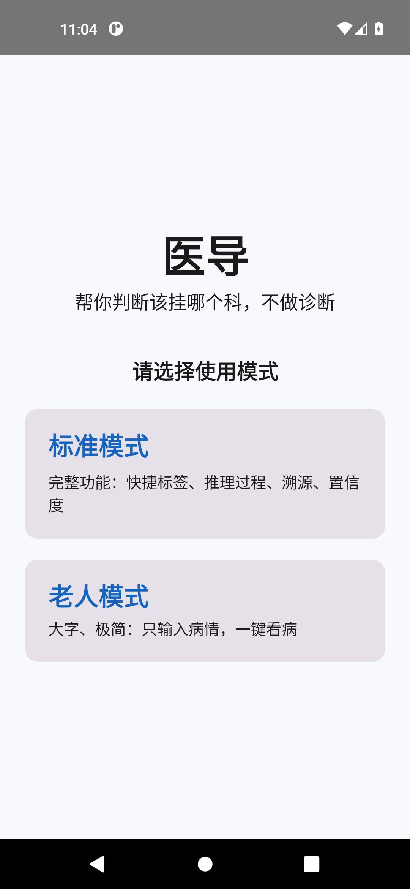
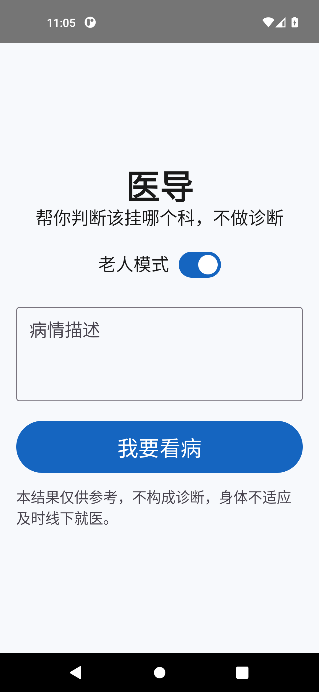
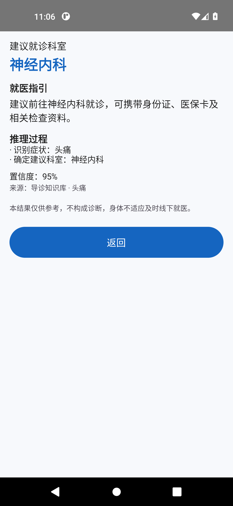
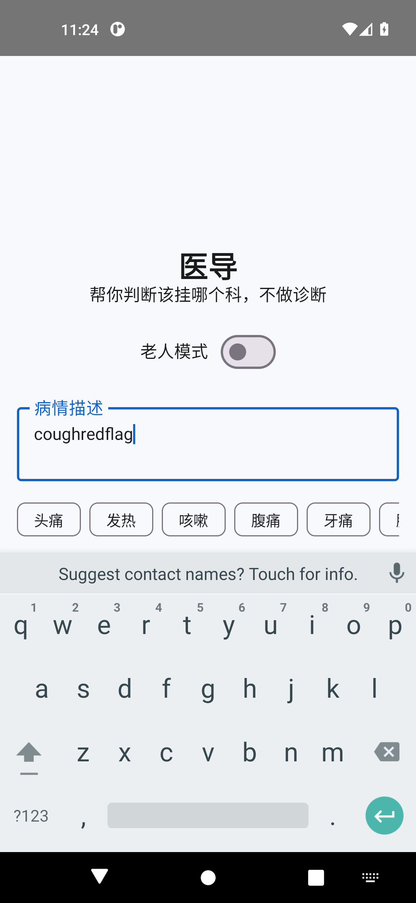

# 医导 · 医疗导诊 Agent Demo

> 基层患者端「合规导诊」Agent：输入症状 → 建议就诊科室，**不输出诊断**。
> 三端同源：安卓 App（原生）+ 浏览器 H5 + 云端 Agent 后端（FastAPI + LLM）。

## 项目简介

「医导」是一个面向基层患者的就诊前合规导诊 Agent。用户用一句话描述症状，系统给出**建议就诊科室**、就医指引与溯源，并严守「不下诊断」的合规红线——疾病名称只作内部推导变量，绝不作为结论输出给用户。

本 Demo 是「KGQA + Agentic 智能问答」产品课程的落地作品，把 PRD / 知识图谱 / Agentic 架构从纸面落地为**可运行的三端系统**。

## 架构

```
┌─ 安卓 App（Kotlin + Jetpack Compose，薄客户端）
├─ 浏览器 H5（原生 HTML/CSS/JS，薄客户端）
└──────────────┐
               ▼
   云端 Agent 后端（FastAPI）
   · 意图路由 · 实体抽取 · 多步规划 · 反思评估 · OutputGuard
   · 内嵌 mini 知识图谱（症状 → 疾病[内部] → 科室）
               │
               ▼
         云 LLM（DeepSeek / GLM，可开关；未配 Key 时规则引擎兜底）
```

**轻量化原则**：客户端只做 UI 与调接口，Agent 全部逻辑、知识图谱、LLM 都在云端，便于复用与扩展。

## 功能特性

- **合规导诊**：`症状 → 建议科室`，全链路无疾病名输出（代码级 OutputGuard 拦截）。
- **Agentic 闭环**：意图路由（简单直达 / 复杂多步 / 高风险 / 工具）、多步规划、反思兜底。
- **老人模式（适老化）**：开机二选一引导页；开启后放大字号、去掉快捷标签/推理/置信度等繁琐元素，只留一个病情输入框 + 大按钮。
- **高风险兜底**：胸痛持续、呼吸困难等 → 红色紧急就医提示，绝不导诊。
- **LLM 增强**：DeepSeek/GLM 生成自然语言就医指引（可开关，无 Key 自动降级到规则引擎）。
- **可解释性**：推理过程步骤条、置信度、来源溯源（老人模式隐藏，保持极简）。

## 目录结构

```
├─ backend/                    # 云端 Agent 后端（FastAPI）
│  ├─ app/
│  │  ├─ main.py               # 入口 + 路由（含 Web UI 托管）
│  │  ├─ pipeline.py           # 导诊流水线编排
│  │  ├─ schemas.py            # 请求/响应模型
│  │  ├─ config.py             # 环境配置（LLM）
│  │  ├─ agent/                # 意图路由 / 实体抽取 / 规划 / OutputGuard
│  │  ├─ kg/                   # mini 知识图谱（数据 + 查询）
│  │  ├─ llm/                  # OpenAI 兼容 LLM 客户端（DeepSeek/GLM）
│  │  └─ static/index.html     # Web 前端（H5）
│  ├─ requirements.txt
│  ├─ .env.example             # 配置模板（复制为 .env 填 Key）
│  └─ run.py
├─ android/                    # 安卓客户端（Kotlin + Compose）
├─ docs/screenshots/           # 运行截图
└─ 医疗Agent Demo开发计划.md     # 完整实施计划（从产品设计到落地）
```

## 快速开始

### 1. 云端后端

```bash
cd backend
python -m pip install -r requirements.txt

# （可选）配置 LLM：复制 .env.example 为 .env 并填入 Key
# 不配置也能跑——自动降级到内置词典 + 规则引擎
cp .env.example .env

python run.py          # 启动于 http://0.0.0.0:8000
```

验证：

```bash
curl http://localhost:8000/health
# {"status":"ok","llm_enabled":true,"provider":"deepseek"}
```

### 2. 浏览器 H5（最快体验）

后端启动后，直接用浏览器打开 <http://localhost:8000/> 即可使用。

### 3. 安卓 App

- 用 Android Studio 打开 `android/`（JDK 17 + SDK 35）。
- 先启动后端，再运行 app。
- 模拟器默认访问 `http://10.0.2.2:8000/`；真机改为电脑局域网 IP（见 `android/app/src/main/java/com/yidao/app/data/api/RetrofitClient.kt`）。

## 运行截图

| 引导页 | 老人模式输入 | 导诊结果 | 高风险兜底 |
|---|---|---|---|
|  |  |  |  |

## 合规说明

- 本 Demo 仅用于技术演示与产品学习，**不构成任何医疗诊断**。
- 内嵌知识图谱为演示用种子数据，非临床依据。
- 全链路「不输出诊断」：疾病节点仅作内部推导，对外只输出科室 + 就医指引 + 免责声明。

## 技术栈

- **后端**：Python / FastAPI / Pydantic / httpx
- **LLM**：DeepSeek（OpenAI 兼容，可切 GLM 等）
- **安卓**：Kotlin / Jetpack Compose / Retrofit / MVVM
- **Web**：原生 HTML / CSS / JS
